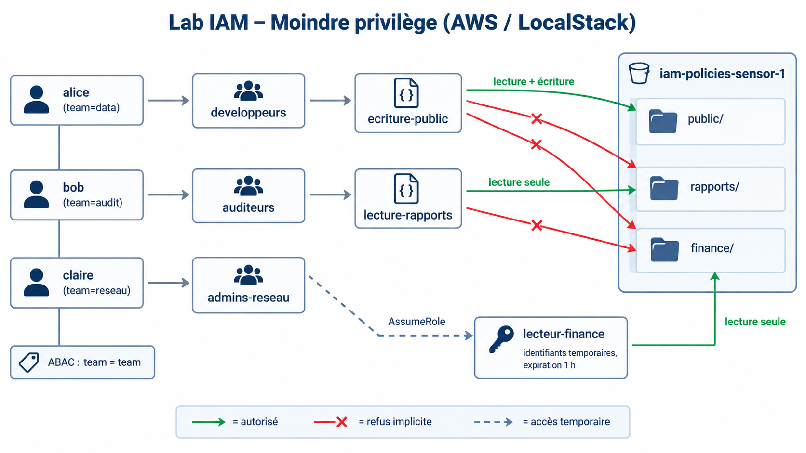
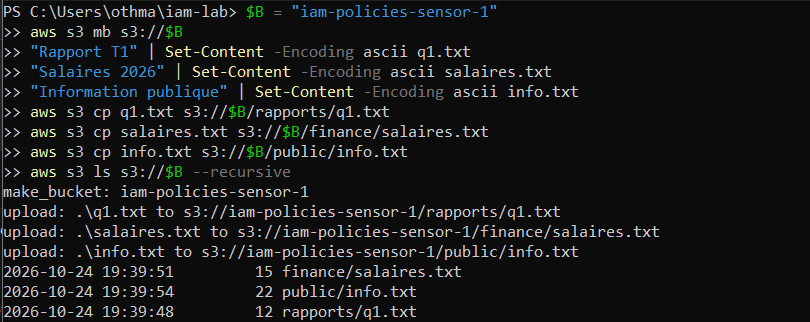
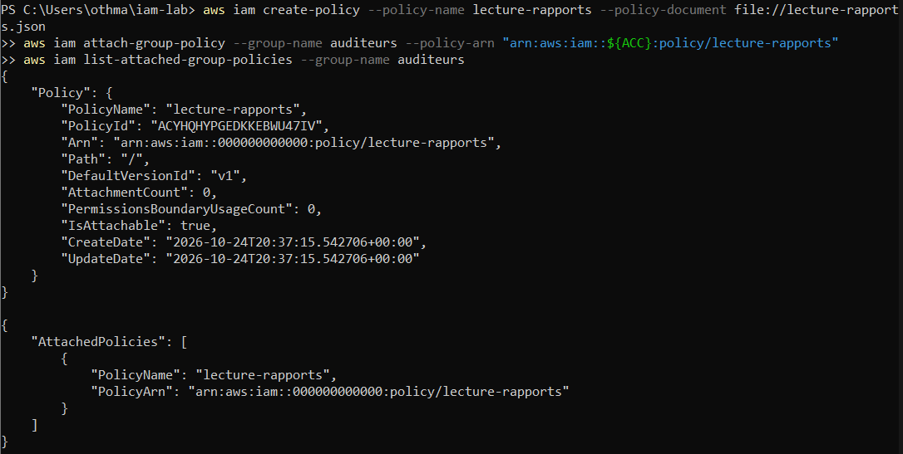
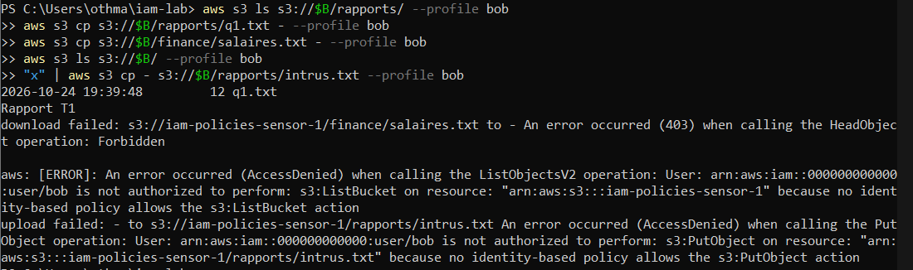
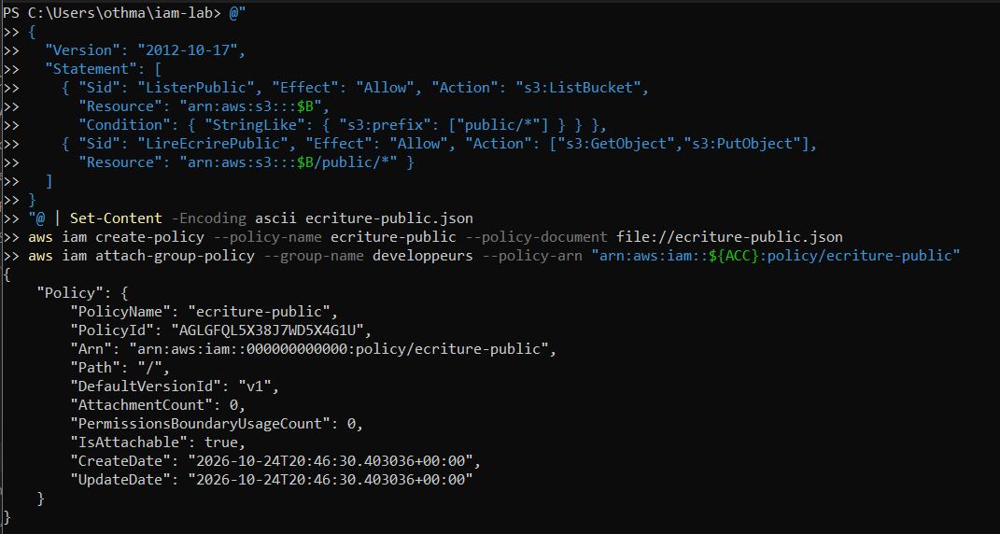
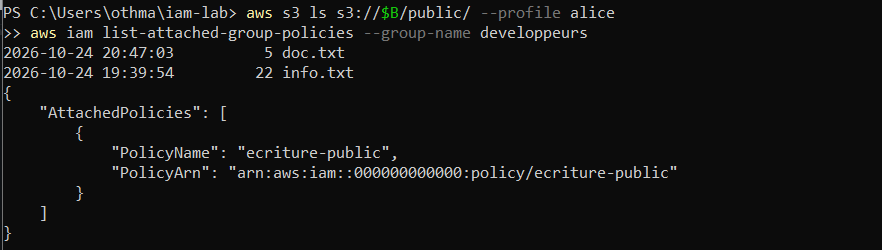
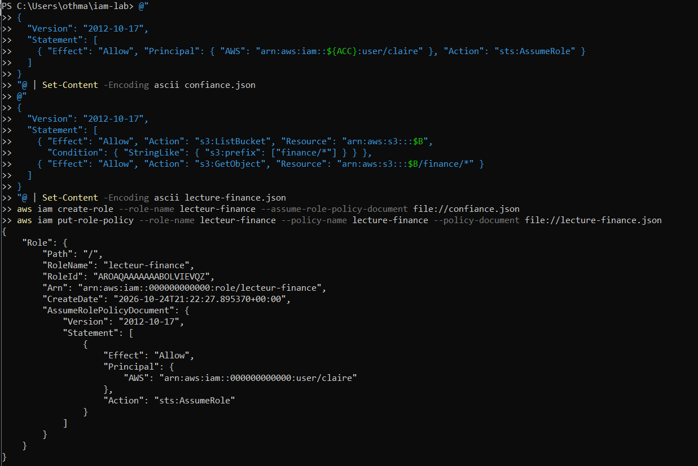
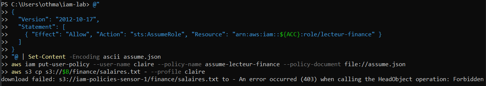
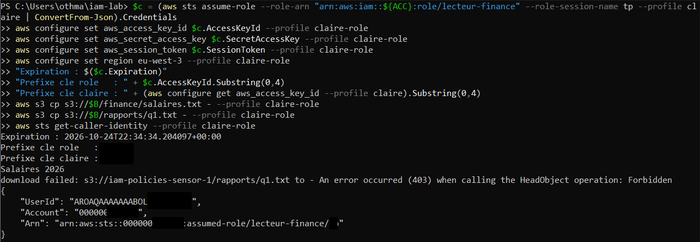
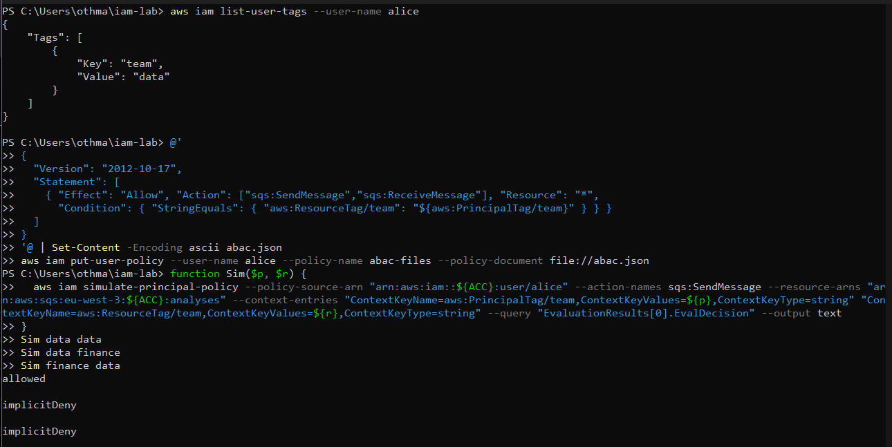

# Politiques IAM au moindre privilège : RBAC, rôle temporaire et ABAC


Écrire des politiques IAM précises, les attacher à des groupes, accorder un accès temporaire par rôle, puis tester chaque droit par des cas autorisés et refusés. Une règle ABAC est évaluée au simulateur. L'ensemble est lu avec un regard **SOC** et **architecte sécurité**.



## En bref

| | |
|---|---|
| **Objectif** | Prouver le moindre privilège par des tests positifs et négatifs : RBAC par groupes, accès temporaire par rôle, ABAC |
| **Environnement** | LocalStack avec application des permissions (`ENFORCE_IAM=1`), publié sur `127.0.0.1:4566` uniquement |
| **Identités** | 3 utilisateurs, 3 groupes, 2 politiques de groupe, 1 rôle temporaire, 1 règle ABAC |
| **Données** | 1 bucket, 3 dossiers de sensibilités différentes : `public/`, `rapports/`, `finance/` |
| **Outils** | AWS CLI v2, PowerShell, Docker, simulateur de politiques IAM |
| **Approche** | 13 tests autorisés ou refusés, lecture des messages de refus |

### Résultats clés

- **Un accès, un dossier, une opération :** bob lit `rapports/`, mais ne peut ni lire `finance/`, ni lister la racine du bucket, ni écrire.
- **Deux déclarations par politique S3 :** lister un bucket (ressource : le bucket, avec condition sur le préfixe) et lire un objet (ressource : les objets) ne portent pas sur la même ressource.
- **Suppression non accordée :** alice dépose et lit dans `public/`, mais la suppression est refusée, car `s3:DeleteObject` n'est accordé nulle part.
- **Accès temporaire :** claire n'a aucun accès direct à `finance/`. Après `AssumeRole`, elle lit `finance/` et rien d'autre, avec des identifiants préfixés `LSIA` (sa clé permanente : `LKIA`) qui expirent au bout d'une heure.
- **ABAC :** une seule règle compare l'étiquette de l'identité à celle de la ressource : `allowed` si elles sont égales, `implicitDeny` sinon.
- **Incident :** deux exécutions successives du script de reconstruction ont créé deux clés actives par utilisateur. Détecté, corrigé, puis script rendu idempotent.

## Périmètre et règles d'engagement

Tout se déroule en local, sans compte AWS réel. Les identifiants `test` sont fictifs, le compte `000000000000` est celui de l'émulateur et le port n'écoute que sur `127.0.0.1`. Aucune clé ni aucun secret n'est versionné. Le profil du rôle temporaire contient un jeton de session : il n'est jamais copié.

## Modèle d'accès

| Identité | Groupe | Mécanisme | Droit effectif |
|---|---|---|---|
| alice (`team=data`) | developpeurs | `ecriture-public` | Lister, lire et déposer dans `public/`, sans suppression |
| bob (`team=audit`) | auditeurs | `lecture-rapports` | Lister et lire `rapports/` |
| claire (`team=reseau`) | admins-reseau | Aucune politique directe, `AssumeRole` sur `lecteur-finance` | Aucun accès direct, lecture de `finance/` pendant la session |

| Fichier | Porte sur | Rôle |
|---|---|---|
| `policies/lecture-rapports.json` | Groupe auditeurs | Liste et lecture de `rapports/` |
| `policies/ecriture-public.json` | Groupe developpeurs | Liste, lecture et dépôt dans `public/` |
| `policies/confiance-lecteur-finance.json` | Rôle (confiance) | Seule claire peut l'endosser |
| `policies/lecture-finance.json` | Rôle (permissions) | Liste et lecture de `finance/` |
| `policies/assume-lecteur-finance.json` | Utilisateur claire | Droit d'assumer ce rôle précis |
| `policies/abac-files.json` | Utilisateur alice | Actions SQS si les étiquettes `team` sont égales |

## Méthodologie et résultats

### 1. Préparer les données

```powershell
$B = "iam-policies-sensor-1"
aws s3 mb s3://$B
aws s3 cp q1.txt s3://$B/rapports/q1.txt
aws s3 cp salaires.txt s3://$B/finance/salaires.txt
aws s3 cp info.txt s3://$B/public/info.txt
aws s3 ls s3://$B --recursive
```



Dans S3, les dossiers n'existent pas : `rapports/q1.txt` est une clé unique dont `rapports/` est un préfixe. C'est pourquoi les politiques utilisent une condition `s3:prefix`.

**Lecture architecte :** la conception des droits commence par la classification des données : public, interne, confidentiel.

### 2. Lecture seule des auditeurs

```powershell
aws iam create-policy --policy-name lecture-rapports --policy-document file://policies/lecture-rapports.json
aws iam attach-group-policy --group-name auditeurs --policy-arn "arn:aws:iam::${ACC}:policy/lecture-rapports"
aws s3 ls s3://$B/rapports/ --profile bob
aws s3 cp s3://$B/rapports/q1.txt - --profile bob
aws s3 cp s3://$B/finance/salaires.txt - --profile bob
aws s3 ls s3://$B/ --profile bob
"x" | aws s3 cp - s3://$B/rapports/intrus.txt --profile bob
```




Les deux premières commandes réussissent, les trois suivantes sont refusées. Un refus par absence de règle se lit « no identity-based policy allows » : c'est un refus **implicite**. Un refus explicite viendrait d'une déclaration `Deny`. Le refus sur `finance/` n'affiche que `403 HeadObject`, car une requête `HEAD` n'a pas de corps de réponse.

**Lecture SOC :** des refus répétés d'un auditeur sur `finance/` ou en écriture sont un signal de reconnaissance ou de compte compromis.

### 3. Dépôt et lecture pour les développeurs

```powershell
aws iam create-policy --policy-name ecriture-public --policy-document file://policies/ecriture-public.json
aws iam attach-group-policy --group-name developpeurs --policy-arn "arn:aws:iam::${ACC}:policy/ecriture-public"
"doc" | aws s3 cp - s3://$B/public/doc.txt --profile alice
aws s3 cp s3://$B/public/info.txt - --profile alice
"doc" | aws s3 cp - s3://$B/finance/doc.txt --profile alice
aws s3 cp s3://$B/rapports/q1.txt - --profile alice
aws s3 rm s3://$B/public/info.txt --profile alice
aws s3 ls s3://$B/public/ --profile alice
```




Le dépôt par flux standard n'affiche rien quand il réussit : le listage final confirme la présence de `doc.txt`.

**Lecture architecte :** séparation des tâches. Les développeurs écrivent sans lire les rapports, les auditeurs lisent sans écrire.

### 4. Rôle temporaire pour la finance

```powershell
aws iam create-role --role-name lecteur-finance --assume-role-policy-document file://policies/confiance-lecteur-finance.json
aws iam put-role-policy --role-name lecteur-finance --policy-name lecture-finance --policy-document file://policies/lecture-finance.json
aws iam put-user-policy --user-name claire --policy-name assume-lecteur-finance --policy-document file://policies/assume-lecteur-finance.json
aws s3 cp s3://$B/finance/salaires.txt - --profile claire
```




Deux côtés doivent s'accorder : la politique de confiance du rôle désigne claire, et claire reçoit le droit d'assumer ce rôle précis. Puis les identifiants temporaires sont récupérés sans jamais être affichés :

```powershell
$c = (aws sts assume-role --role-arn "arn:aws:iam::${ACC}:role/lecteur-finance" --role-session-name session-claire --profile claire | ConvertFrom-Json).Credentials
aws configure set aws_access_key_id $c.AccessKeyId --profile claire-role
aws configure set aws_secret_access_key $c.SecretAccessKey --profile claire-role
aws configure set aws_session_token $c.SessionToken --profile claire-role
aws configure set region eu-west-3 --profile claire-role
aws s3 cp s3://$B/finance/salaires.txt - --profile claire-role
aws s3 cp s3://$B/rapports/q1.txt - --profile claire-role
aws sts get-caller-identity --profile claire-role
```



La lecture de `finance/` réussit, celle de `rapports/` est refusée : le rôle **remplace** les droits de claire, il ne s'y ajoute pas. L'identité affichée est celle du rôle (`assumed-role/lecteur-finance/...`).

**Lecture SOC :** chaque `AssumeRole` laisse un événement identifiable (qui, quand, quel rôle). Une assomption hors horaires vers un rôle sensible est à surveiller.

**Lecture architecte :** le droit n'est plus permanent mais emprunté, avec une date d'expiration. Si les identifiants fuient, la fenêtre d'abus se referme seule.

### 5. ABAC évalué au simulateur

```powershell
aws iam put-user-policy --user-name alice --policy-name abac-files --policy-document file://policies/abac-files.json
```

La règle autorise des actions SQS seulement si l'étiquette `team` de la ressource est égale à celle de l'identité. Le fichier est écrit avec des guillemets simples sous PowerShell : avec des guillemets doubles, `${aws:PrincipalTag/team}` serait remplacé par du vide avant l'envoi.

```powershell
function Sim($p, $r) {
  aws iam simulate-principal-policy --policy-source-arn "arn:aws:iam::${ACC}:user/alice" --action-names sqs:SendMessage --resource-arns "arn:aws:sqs:eu-west-3:${ACC}:analyses" --context-entries "ContextKeyName=aws:PrincipalTag/team,ContextKeyValues=${p},ContextKeyType=string" "ContextKeyName=aws:ResourceTag/team,ContextKeyValues=${r},ContextKeyType=string" --query "EvaluationResults[0].EvalDecision" --output text
}
Sim data data
Sim data finance
Sim finance data
```



**Lecture SOC :** avec l'ABAC, les étiquettes deviennent des droits. Celui qui peut modifier son étiquette modifie ses accès : les appels de type `TagUser` sont à surveiller.

## Matrice de tests

| Identité | Action testée | Attendu | Observé |
|---|---|---|---|
| bob | Lister `rapports/` | Autorisé | Autorisé |
| bob | Lire `rapports/q1.txt` | Autorisé | Autorisé |
| bob | Lire `finance/salaires.txt` | Refusé | Refusé (403) |
| bob | Écrire dans `rapports/` | Refusé | Refusé (AccessDenied) |
| alice | Écrire dans `public/` | Autorisé | Autorisé |
| alice | Écrire dans `finance/` | Refusé | Refusé (AccessDenied) |
| alice | Supprimer dans `public/` | Refusé | Refusé (AccessDenied) |
| claire (directe) | Lire `finance/salaires.txt` | Refusé | Refusé (403) |
| claire (rôle) | Lire `finance/salaires.txt` | Autorisé | Autorisé |
| claire (rôle) | Lire `rapports/q1.txt` | Refusé | Refusé (403) |
| Simulateur | `team=data`, ressource `data` | allowed | allowed |
| Simulateur | `team=data`, ressource `finance` | implicitDeny | implicitDeny |
| Simulateur | `team=finance`, ressource `data` | implicitDeny | implicitDeny |

## Incident : clés d'accès en double

Le script de reconstruction a été exécuté deux fois à une minute d'écart. La seconde exécution a échoué sur `create-user` (l'utilisateur existait), mais a quand même créé une nouvelle clé : chaque utilisateur avait alors deux clés actives. Le listage des clés a montré deux dates de création par utilisateur, la plus ancienne a été supprimée et le profil de la CLI conserve la plus récente.


**Lecture architecte :** un script de provisionnement doit être idempotent. [`scripts/01-provision-identities.ps1`](scripts/01-provision-identities.ps1) teste l'existence avant de créer et ne génère une clé que pour un utilisateur nouvellement créé.

## Limites

- L'environnement est émulé : le comportement peut différer d'un vrai compte AWS, notamment pour le simulateur.
- L'ABAC n'est testé qu'au simulateur, avec des étiquettes fournies explicitement : aucune file SQS n'a été créée.
- Seuls des refus implicites sont testés. Aucun `Deny` explicite, aucune limite de permissions, aucune politique de contrôle de service.
- Deux politiques sont rattachées directement à un utilisateur (`assume-lecteur-finance` sur claire, `abac-files` sur alice), ce qui s'écarte de la bonne pratique : droits portés par des groupes ou des rôles.
- Les clés d'accès sont des identifiants de longue durée, acceptables ici, à proscrire en production.
- Les horodatages sont en UTC.

## Vision d'architecte sécurité et recommandations

Le laboratoire prouve que des droits étroits, vérifiés par des tests négatifs, tiennent sur un cas simple. Il ne prouve pas qu'ils tiendraient face à une erreur humaine : toutes les règles sont des `Allow`, donc une politique ajoutée par erreur ouvrirait `finance/` sans rien pour s'y opposer. Les recommandations suivantes, non testées ici, comblent cet écart.

| Priorité | Recommandation | Justification |
|---|---|---|
| P1 | Ajouter un `Deny` explicite sur `finance/` pour tout principal autre que le rôle `lecteur-finance`, par politique de bucket, limite de permissions ou politique de contrôle de service | Un `Deny` l'emporte sur tout `Allow` ajouté par erreur |
| P1 | Réserver les actions d'étiquetage (`iam:TagUser`, `iam:TagRole`, `iam:UntagUser`) à l'administration, avec des conditions sur les clés d'étiquette | Avec l'ABAC, modifier une étiquette modifie les accès |
| P1 | Exiger le MFA pour assumer le rôle (condition `aws:MultiFactorAuthPresent` dans la politique de confiance) et garder des sessions courtes | Un secret volé ne suffit plus pour atteindre `finance/` |
| P2 | Remplacer les clés permanentes par une fédération (SSO) et des rôles ; une seule clé active et rotation si elles subsistent | Réduire l'impact d'un vol de clé |
| P2 | Remplacer les politiques rattachées aux utilisateurs par des politiques gérées rattachées à des groupes ou à des rôles | Revue et révocation centralisées |
| P2 | Journaliser les événements de données sur `finance/` et alerter sur `AssumeRole` vers `lecteur-finance` hors horaires, `AttachGroupPolicy`, `PutUserPolicy`, `TagUser`, `CreateAccessKey` et les rafales d'`AccessDenied` | Détecter l'élévation de privilèges et la reconnaissance |
| P2 | Valider les politiques avant déploiement (analyse de politique IAM Access Analyzer, simulateur en intégration continue) et les relire par demande de fusion | Les droits deviennent du code relu et testé |
| P3 | Durcir S3 : blocage de l'accès public, chiffrement avec une clé dédiée à `finance/`, versionnement | Défense en profondeur sur la donnée la plus sensible |

Ordre de mise en œuvre : d'abord ce qui empêche une erreur de devenir une fuite (le `Deny` explicite, l'étiquetage protégé, le MFA sur le rôle), puis ce qui réduit les secrets de longue durée, puis la détection et la validation automatique.

## Compétences démontrées

- Rédaction de politiques IAM au moindre privilège : actions, ressources, conditions de préfixe.
- RBAC par groupes, rôle temporaire avec politique de confiance, ABAC par étiquettes.
- Tests positifs et négatifs, lecture des refus implicites et explicites, lien avec les journaux d'audit.
- Détection et correction d'un écart de configuration (clés en double), scripts idempotents.
- Analyse des limites et recommandations priorisées d'architecte sécurité.

## Reproduire

1. Démarrer LocalStack avec `ENFORCE_IAM=1` sur `127.0.0.1:4566`.
2. Exécuter `scripts/01-provision-identities.ps1` puis `scripts/02-deploy-policies.ps1`.
3. Rejouer les tests des sections 2 à 5.
4. Nettoyer : arrêter et supprimer le conteneur, supprimer les profils de test de `~/.aws/credentials` et de `~/.aws/config`.

## Structure du dépôt

```text
.
├── README.md
├── policies/      six politiques JSON
├── scripts/       reconstruction des identités et déploiement des politiques
└── docs/images/   schéma et captures numérotées
```

## Autres projets

- [aws-iam-identities-least-privilege-lab](https://github.com/othmane71-art/aws-iam-identities-least-privilege-lab) : identités IAM, refus par défaut, MFA et inventaire
- [cloud-exposure-audit-nmap-zap-prowler](https://github.com/othmane71-art/cloud-exposure-audit-nmap-zap-prowler) : audit d'exposition et de posture cloud (Nmap, OWASP ZAP, Prowler)
- [ARCHISOC-LAB-HOME](https://github.com/othmane71-art/ARCHISOC-LAB-HOME) : architecture SOC virtualisée (FortiGate, pfSense, Wazuh, honeypot Cowrie, WAF, DVWA)
- [Microsoft-Sentinel-SOC-Lab](https://github.com/othmane71-art/Microsoft-Sentinel-SOC-Lab) : SOC hybride avec Microsoft Sentinel et règles de détection KQL
- [forensic-artefacts-goad-mini-kali](https://github.com/othmane71-art/forensic-artefacts-goad-mini-kali) : investigation forensic live sur Windows Server AD et Kali Linux
